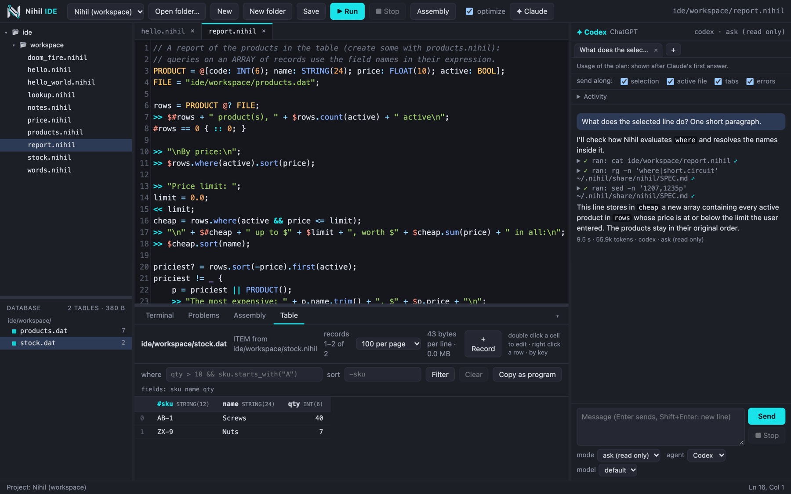

<p align="center">
  <picture>
    <source media="(prefers-color-scheme: dark)" srcset="assets/logo-dark.png">
    
  </picture>
</p>

<p align="center"><a href="https://github.com/nihillang/nihil/actions/workflows/tests.yml"></a></p>

# Nihil

A small programming language with **no keywords at all**: no `if`, no `while`,
no `return`, only symbols. It compiles straight to x86_64 Linux machine code,
with no libc, no linker and no virtual machine, and its compiler is written in
Nihil itself. The name is Latin for *nothing*, and `_` is the value that is not
there.

- **Self-hosted.** A first compiler in assembly bootstraps a second one written
  in Nihil, which then compiles itself to a fixed point. Both produce the same
  bytes for every program the first one accepts.
- **Statically typed, without annotations.** Types come from values and
  defaults, across several passes.
- **Batteries for data.** Files of fixed-width records, with an index on disk
  for reading, writing and deleting by key, and queries like
  `rows.where(price > 10.0).sort(name)`.
- **Memory is managed.** A conservative garbage collector lives in the small
  runtime embedded in each executable. A "hello world" is 6 KB.

The full specification is in [SPEC.md](SPEC.md). Website: [nihil-lang.dev](https://nihil-lang.dev).

## A taste

```text
fib(n = 0) {
    n < 2 { : n; }                 // a BOOL before "{" is an if; ":" returns
    : fib(n - 1) + fib(n - 2);
}

find(v = [0], x = 0) {
    i = 0;
    * i < #v {                     // "*" is a while loop
        v[i] == x { : i; }
        i = i + 1;
    }
    : _;                           // "_" is "no value": find returns INT?
}

>> fib(30); >> "\n";               // 832040
pos = find([5, 8, 13], 8) || -1;   // "||" takes the value, or the fallback
3 { >> pos; }                      // an INT before "{" repeats the block: 111
>> "\n";
>> 0.1 + 0.2; >> "\n";             // 0.30000000000000004
words = "  pear, apple, fig ".trim().split(", ");
>> words.sort().join(" < ") + "\n";  // apple < fig < pear
```

And a small table on disk:

```text
PRODUCT = @[#code: INT(4); name: STRING(12); price: FLOAT(6)];   // a data model; # marks the key
FILE = "products.dat";

@{}>> FILE, PRODUCT(1, "Coffee", 12.5);    // write by key: adds it, or replaces it in place
@{}>> FILE, PRODUCT(2, "Tea", 8.0);
@{}>> FILE, PRODUCT(3, "Cake", 15.0);

p = PRODUCT @{2} FILE;                      // one record by its key (a hash index on disk)
p.price = 7.5;
@{}>> FILE, p;

rows = PRODUCT @ FILE;                      // the whole table: an ARRAY of PRODUCT
>> $rows.where(price < 13.0).sort(name);    // a query; $ turns records into table lines
>> "total: " + $rows.sum(price) + "\n";     // total: 35.0
PRODUCT @{3} FILE = _;                      // delete by key
```

`products.dat` is plain text, one record per line, which you can read with any
editor:

```text
   1Coffee        12.5
   2Tea            7.5
```

## Install

```sh
curl -fsSL https://nihil-lang.dev/install.sh | sh
```

It installs the latest release in `~/.nihil` and links `~/.local/bin/nihil`, with
no sudo. Supported: **Linux on x86_64**, and **macOS on Apple silicon** with the
Xcode Command Line Tools (`xcode-select --install`). On Windows, use WSL.

```sh
printf '%s\n' '>> "Hello, Nihil!\n";' > hello.nihil
nihil run hello.nihil        # compile and run: Hello, Nihil!
nihil hello.nihil            # or compile into ./hello, a native executable
nihil version
nihil ide                    # the IDE, in an app window (your workspace: ~/Nihil)
nihil ide stop               # stop the IDE's server, which runs in the background
```

Releases and checksums: [github.com/nihillang/nihil/releases](https://github.com/nihillang/nihil/releases).

How fast tables are (write, read, query and change a million records, on Linux and macOS):
[nihil-lang.dev/performance](https://nihil-lang.dev/performance.html); `bench/run.sh` measures your machine.

The newest build of `main`, made by GitHub on every push (not a release: it may break):
`curl -fsSL https://nihil-lang.dev/install.sh | NIHIL_VERSION=nightly sh`. The packages of any
push are also kept with its run in Actions (Artifacts), for 90 days.

## Building from source

You need Linux on x86_64, `make` and `curl`. `python3` is only used by `make floatcheck`
and the IDE.

With `nasm` and `ld` (binutils) installed, `make` builds stage 0 (the compiler in assembly)
and compiles stage 1 with it. Without them, it downloads the latest release's compiler
(`dist/seed.sh`, checked against its `.sha256`), which compiles stage 1, and the result
compiles it again: the same bytes stage 0 gives (`make seedcheck`). The runtime that goes
into every executable is kept assembled in `src1/runtime_bin.nihil`; only a change to
`src/runtime.asm` needs `nasm` (`make runtime`).

```sh
git clone https://github.com/nihillang/nihil.git && cd nihil
make                                        # both compilers, in build/
printf '%s\n' '>> "Hello, Nihil!\n";' > hello.nihil
./nihilc1.sh hello.nihil hello && ./hello   # Hello, Nihil!
```

On macOS (Apple silicon), `./nihilc1.sh` builds native executables through a
translator to ARM64 (`macos/nihil`; see [docs/macos-arm64.md](docs/macos-arm64.md)).
A Mac builds its first compiler from the Linux one (the release workflow does it in
`.github/workflows/release.yml`), and rebuilds it by itself after that.

`./nihilc1.sh` is the current compiler. `build/nihilc`, the one in assembly, is
frozen and only bootstraps; it accepts the language as it was when it first
compiled stage 1 (no optionals, FLOAT or anything newer).

## The language at a glance

| Write | Meaning |
|---|---|
| `x = 1;` | a variable; its type comes from the value (INT, FLOAT, BOOL, STRING, ARRAY, records) |
| `cond { … } \|\| cond { … } \|\| { … }` | if / else if / else (`cond` is a BOOL) |
| `* cond { … }` | while |
| `n { … }` | repeat `n` times (`n` is an INT) |
| `f(a = 0, s = "") { … }` | a method; every parameter has a default, which gives its type |
| `: value;` / `:;` | return |
| `:: code;` | end the program, with an exit code |
| `>> x;` / `!>> x;` / `<< x;` | write to standard output / to standard error / read a line into `x` |
| `x? = 5;`, `x = _;`, `x \|\| 0`, `x == _` | optionals: a value that may be missing |
| `#s`, `s[i]`, `[0 ; n]`, `a + b` | length, index, an array of `n` copies, joining |
| `$42`, `$[72, 105]`, `"42".int()` | text of a number, text from bytes, number from text |
| `.n`, `#f` | INT to FLOAT, FLOAT to INT |
| `@ path`, `@? path`, `@>> path, text;`, `@+>> path, text;` | read a file (or `_`), replace it atomically, append to it |
| `... ms;` | wait |
| `@ "other.nihil";` | include another file |
| `m = {"ana": 30}`, `m[k] = v;`, `m[k] \|\| 0`, `m[k] = _;` | a MAP: values by key, in memory (§22) |
| `s.find(t)`, `v.sort()`, `rows.where(cond)` | the library, called on values (§21) |

The names after a `.` exist only there, so they never take a name from your
program.

## The IDE

`ide/` is a small IDE whose server is written in Nihil (`ide/server.nihil`). With Nihil
installed, `nihil ide` starts it and opens it in an app window (Chrome, Edge, Brave or
Chromium with `--app`; the default browser otherwise). Its workspace is `~/Nihil`, where
the examples are copied the first time. The server runs in the background, with its log in
`~/Nihil/.nihil-ide/server.log`, and `nihil ide stop` stops it; `nihil ide --foreground` keeps
it in the terminal instead (Ctrl+C stops it). From the repository:

```sh
make ide && ./build/ide-server             # then open http://127.0.0.1:8730
```

<p align="center"></p>

It has an editor with Nihil highlighting and a color terminal for the
program's output and input. Compile errors are marked in the code, and the
generated machine code is one click away. The **Table** tab shows any `.dat`
file in columns, using the data model that describes it, a page at a time (the
server reads only the lines shown, so tables of hundreds of MB open at once).
**Projects:** any folder in your home directory can be opened as a project; its
programs and tables are listed, and programs run inside it. The language
repository itself is the first project (files in `ide/workspace/` and
`examples/`). Saving a file that changed on disk since it was opened asks first.
**The server runs any code it receives:** it listens only on `127.0.0.1`; reach
it from another machine through an SSH tunnel.

## How it works

| Path | Contents |
|---|---|
| `src/nihilc.asm`, `src/commands.inc` | stage 0: the compiler in assembly (frozen) |
| `src/runtime.asm`, `src/layout.inc` | the runtime copied into every executable: I/O, files, the heap and its garbage collector |
| `src1/` | stage 1: the compiler written in Nihil (`nihilc1.nihil` lists its parts) |
| `src1/bigint.nihil`, `float_text.nihil`, `prelude.nihil` | the prelude, in Nihil: exact FLOAT ⇄ text, records, the key index and the library; a program gets only the methods it reaches |
| `tests/` | the test suite (`tests/stage1/` for the newer features) |
| `examples/`, `ide/workspace/` | example programs, including the PSX Doom fire on a 24-bit color terminal |
| `ide/` | the web IDE |

The compiler writes the ELF file by itself, one pass at a time, until the types
settle. The generated code is a stack machine with a peephole optimizer (locals
in registers, fused compare-and-branch, `cmov`). [SPEC.md](SPEC.md) explains
each part, and its Appendix A records why each decision was made.

## Testing

```sh
make test            # stage 0 on the test suite
make test1           # stage 1 on the suite and its own tests
make test1-O0        # the same, without optimizations
make compare         # stage 0 and stage 1 -O0 give identical bytes for every program both accept
make fixedpoint      # stage 1 compiles itself to a fixed point
make floatcheck      # FLOAT ⇄ text checked against Python on 100,000 numbers
make gcstress        # the suite and the fixed point with a collection every 256 KiB
```

GitHub Actions runs all of them on every push, on a clean Ubuntu.

## Contributing and security

See [CONTRIBUTING.md](CONTRIBUTING.md). To report a vulnerability, write to
security@nihil-lang.dev ([SECURITY.md](SECURITY.md)).

## License

MIT: see [LICENSE](LICENSE).
